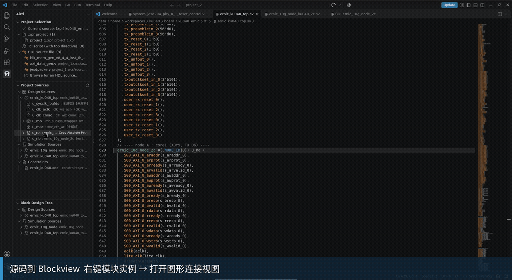
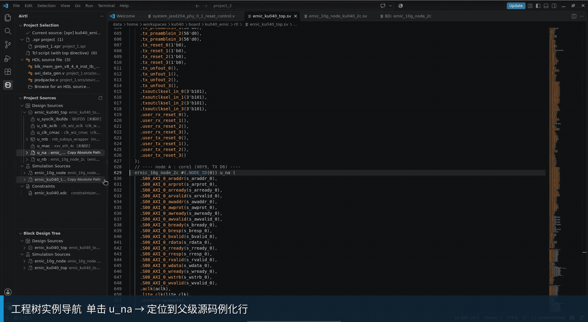
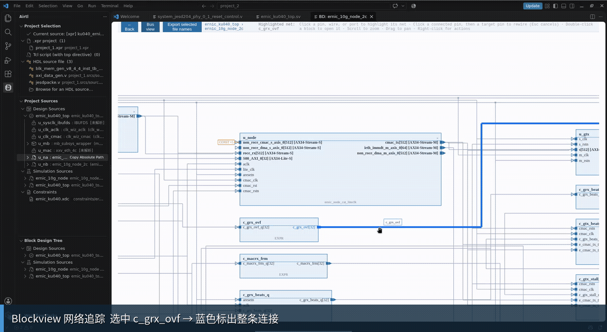
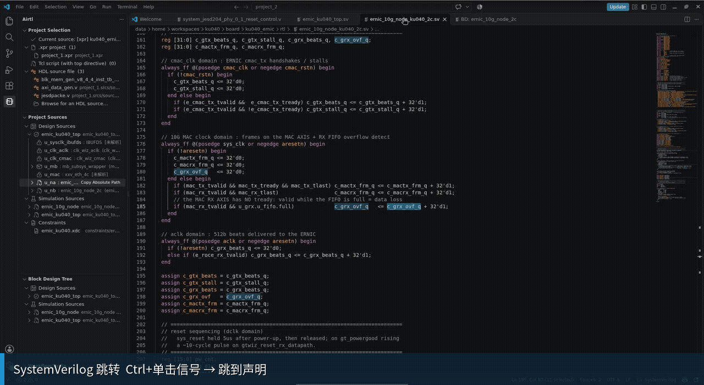
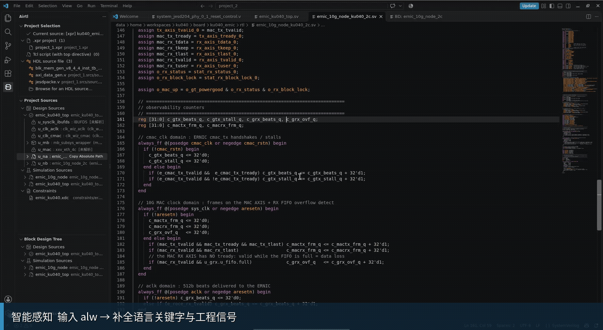
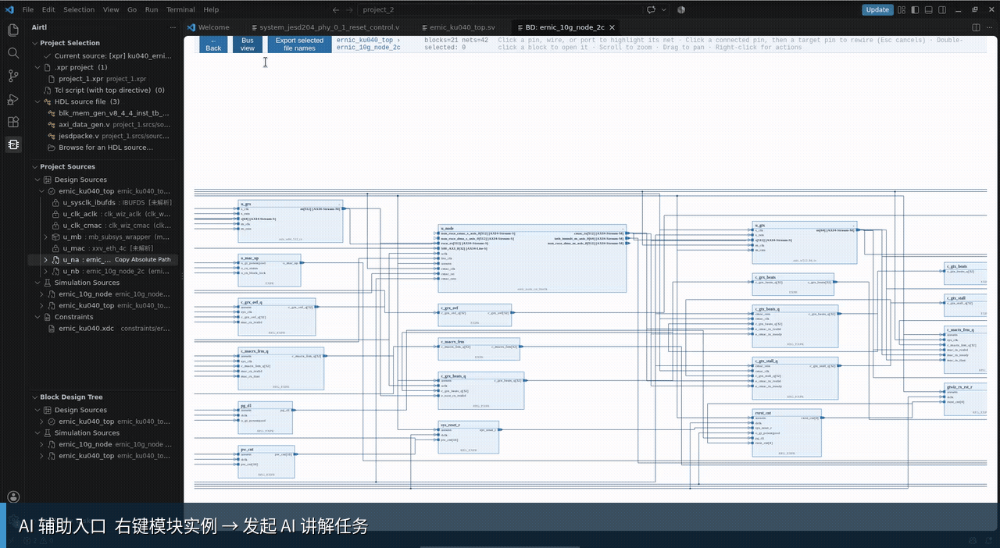

# Airtl

**Airtl 是面向 RTL/FPGA/FPSoC 开发的 VS Code 插件。** 核心体验是直接从 Verilog/SystemVerilog 源码生成模块 Blockview：即使没有 Vivado 工程，也可以从源码文件建立模块层次、查看端口和网络连接，并在源码与图形视图之间定位。已有 Vivado 工程时，还可读取 `.xpr` 和工程上下文。

**1.1.0-preview 提供 Windows x64 与 Linux x64 安装包。** [Windows x64 下载](https://github.com/yuairtl/Airtl/raw/refs/heads/main/airtl-1.1.0-preview-win32-x64.vsix) · [Linux x64 下载](https://github.com/yuairtl/Airtl/raw/refs/heads/main/airtl-1.1.0-preview-linux-x64.vsix)。推荐使用 VS Code 1.126.0 或更高版本；该推荐版本和 Airtl 第一版均于 2026 年 6 月发布。

## 从纯源码直接打开 Blockview

不需要先准备 Vivado 工程文件。打开 Verilog/SystemVerilog 源码后，可将源码作为工程入口，解析模块定义、例化、端口和连接关系，并打开对应 Blockview；可继续进入子模块，也可返回上一级。Vivado 工程是另一种入口：选择 `.xpr` 或指定顶层的 Tcl 脚本后，Airtl 还会整理设计源、仿真源、约束和工程层次。

在 Project Sources 中，单击模块实例会打开它在父模块中的例化位置；双击可跳到模块定义。右键实例并选择 **Open Block Design for Module** 可打开对应 Blockview，也可以从 Block Design Tree 选择模块进入图形视图。这样能沿着“工程层次 → 实例 → 源码定义 → 模块连接图”连续查看，而不必手工在大工程里反复搜索文件和实例名。

## 在 Blockview 中追踪端口和网络

Blockview 将当前模块的实例、端口、总线和网络连接绘制在同一视图中。选择端口或网络可高亮相关连接路径；对子模块可继续进入下一层，也可返回父级视图。

图中对象可定位到源码定义或例化位置。对于需要调整的连接，Airtl 通过 VS Code 文档编辑应用改动，支持用 Ctrl+Z 撤销。Blockview 用于帮助阅读和检查结构关系，不代替 Vivado 的综合或实现结果。

## SystemVerilog 编辑器支持

Airtl 自带 `.v/.vh/.sv/.svh` 语法高亮，不依赖其他 Verilog 插件。工程级智能感知默认开启，提供：

- Ctrl+单击跳转到变量、类型、模块、宏和 include 定义。
- 查找引用、悬停信息、文件大纲和文档内同符号高亮。
- 按当前语境补全 SystemVerilog 关键字、宏、类型、参数、信号及例化端口。
- 例化参数和端口签名提示、局部符号重命名与可用的诊断修复建议。
- 根据 Slang 预处理上下文淡化未生效的条件编译代码；工程宏和 include 路径参与编辑器分析。

语法分析和工程级智能感知会随当前编辑内容更新。源码编辑分析与工程网表、布局和 Blockview 刷新分开运行；语义索引更新不会因每次输入而重建整张设计图。可在设置 `airtl.systemverilog.intelliSense.enabled` 中关闭智能感知，减少后台索引开销。

> **VHDL 版本说明：**1.1.0-preview 暂时移除 VHDL 网表及连线提取支持。由于连线提取有效性尚未达到发布要求，本版不提供 VHDL Blockview；计划在下个版本完成修复和验证后恢复。

## AI 辅助工作流

Airtl 可连接配置的 AI 工具，并从工程树或 Blockview 发起与当前设计相关的任务，例如：

- 让 AI 阅读模块源码并说明模块功能及其在当前工程中的作用。
- 将所选模块子图和源码信息交给 AI，生成或补全 testbench。
- 从 Airtl 的仿真、综合、实现和生成 Bitstream 工作流中向 AI 发起任务。
- 对选中的 IP 发起端口资料查询任务。

AI 工作流依赖本机已安装并配置的 AI 客户端、对应模型服务以及用户提供的提示词或技能文件。公开版本不包含 AI 辅助相关技能；这些技能和配置不会在安装后自动就绪。Airtl 不会把 AI 执行结果当作 Vivado 验证结果。

动图展示任务入口；实际 AI 对话需要配置兼容的 AI 工具、模型服务和技能文件。

## 开始使用

1. 在 VS Code 打开包含 Vivado 工程或 HDL 源码的工作区。
2. 在 Airtl 的“工程选择”中选择 `.xpr`、Tcl 脚本或 HDL 源文件。
3. 从 Project Sources 浏览源码和实例；单击实例跳到父级例化位置，双击跳到模块定义。右键实例并选择 **Open Block Design for Module** 打开 Blockview。
4. 在 Blockview 中选择端口或网络查看高亮路径，也可从节点命令定位源码。

建议使用 **Visual Studio Code 1.126.0 或更高版本**。1.126.0 于 2026 年 6 月发布；更早版本尚未完成全面兼容性测试，因此这是推荐版本，不代表已确认的最低版本要求。

## 支持范围和版本说明

Airtl 提供工程静态分析、源码辅助和连接可视化，不替代 Vivado 的综合、仿真与实现。生成 IP 可作为模块边界参与工程视图；加密实现和纯 stub 只提供可获得的声明信息，不会被展开成内部 RTL。

项目部分代码已开源。公开版本需要联网运行，目前全员免费开放试用；公开版本不包括 AI 辅助相关技能，使用者需要自行填写。如需 AI 技能、AI 环境配置或离线使用，请联系 Airtl。

## 联系方式

作者：Airtl yu

邮箱：yuairtl@outlook.com
